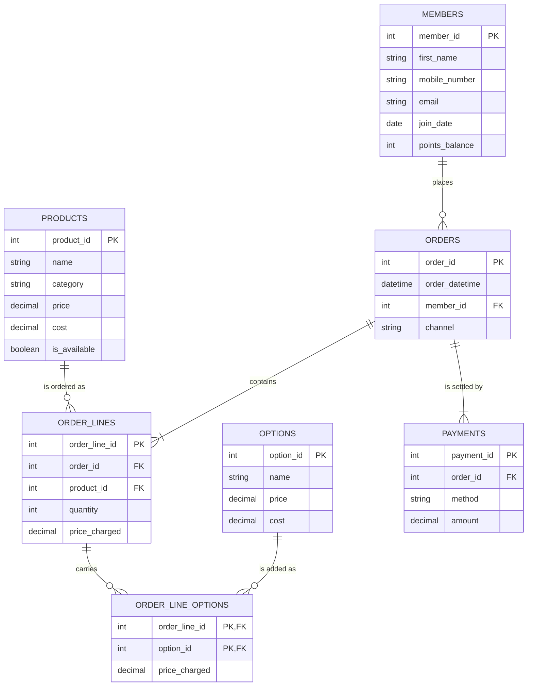

# Babson Bean Café — Database Project

## 1. The Scenario

**Scenario C — Babson Bean Café.** Babson Bean is a café on campus. Today its till records sales and its loyalty program lives on punch cards, and neither can answer a question. The café wants to know what sells, which add-ons (options like extra shot, oat milk, vanilla syrup) earn their keep, and who its regular customers are. This project builds a database that holds loyalty members, the menu, the options a drink can carry, orders, the lines and options on each order, and the payments that settle each order — so those questions can be answered with SQL instead of guesswork.

## 2. The ERD

## 3. What One Row Means

- One row of `members` is one loyalty member who has joined the program, with the mobile number and points balance they currently have.
- One row of `products` is one item that can appear on the menu, with the price and cost it has today and whether it is available today.
- One row of `options` is one add-on a drink can carry, such as oat milk, with the price and cost of adding it once.
- One row of `orders` is one order placed at the café, at one date and time, through one channel, by a member if one was involved.
- One row of `order_lines` is one product on one order, at the quantity ordered and the price charged that day.
- One row of `order_line_options` is one option added to one order line, at the price charged that day.
- One row of `payments` is one amount paid toward one order, by one method.

## 4. Design Choices

- **Keys instead of the business's own identifiers.** Members have a mobile number and an optional email, but a mobile number can change and an email can be missing, so neither can be a primary key — I used a surrogate `member_id` instead. The same reasoning applies to `product_id` and `option_id`: a menu name could in principle repeat or be renamed, so a surrogate key is safer than the name.
- **Optional relationships.** `orders.member_id` is optional, because "customers who are not members buy too, and their orders name no customer." `members.email` is optional because the scenario says so directly. A line's options are optional too — a line can carry zero, one or several, and food and drink lines that take no options still need to exist.
- **A rule no `CHECK` can hold.** "An order's payments add up to the order's total" spans four tables (`orders`, `order_lines`, `order_line_options`, `payments`), and a `CHECK` constraint can only look at one row of one table. `build.py` checks it instead with a query (the `order_totals` view), comparing what an order's lines and options charged against what its payments add up to.
- **What I changed.** I restricted options to lines whose product is coffee or tea when generating the data, since oat milk on a bagel doesn't make sense for this café — the table itself still allows an option on any line, because the scenario never rules that out, and I didn't want the schema to assume a business rule the café hadn't actually stated.

